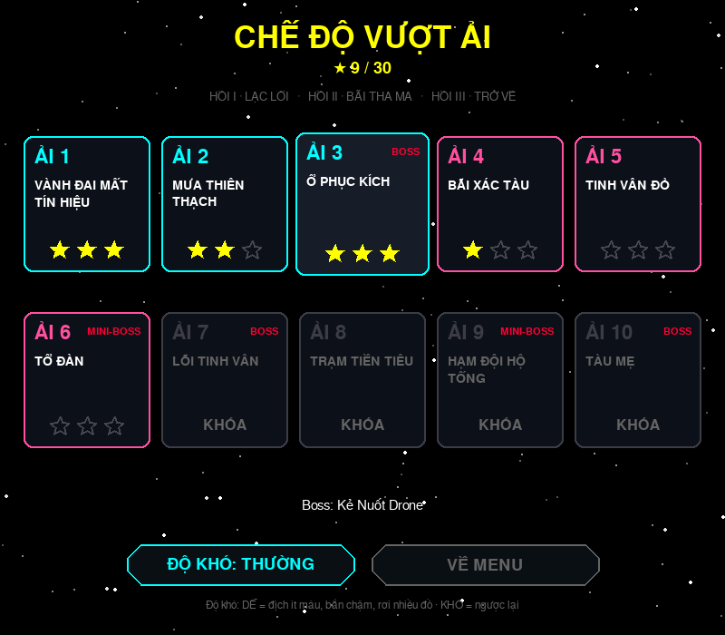
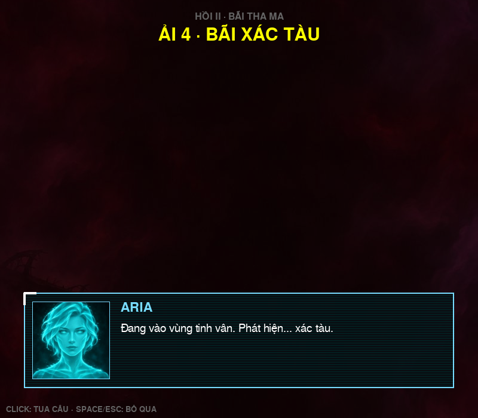
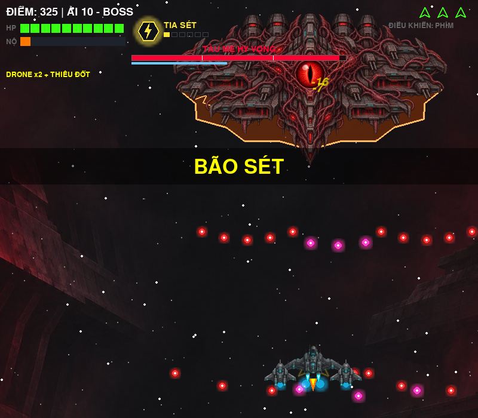

<h2 align="center">
    <a href="https://dainam.edu.vn/vi/khoa-cong-nghe-thong-tin">
    🎓 Faculty of Information Technology (DaiNam University)
    </a>
</h2>
<h2 align="center">
   SpaceShip10k
</h2>
<div align="center">
    <p align="center">
        
        
        
    </p>

[](https://www.facebook.com/DNUAIoTLab)
[](https://dainam.edu.vn/vi/khoa-cong-nghe-thong-tin)
[](https://dainam.edu.vn)

</div>

---

## 1. Giới thiệu

Game bắn phi thuyền điều khiển **bằng cử chỉ tay qua webcam** (MediaPipe), làm trong môn
Công nghệ xử lý ảnh. Không có webcam vẫn chơi được bằng **bàn phím**.

> Phiên bản **2.x** là bản đại tu toàn bộ: tách code thành package `spaceship/`, sửa lỗi game chạy
> chậm theo webcam, thêm điều khiển bàn phím, lưu thống kê cộng dồn, có test tự động.
> Chi tiết thay đổi: [CHANGELOG.md](CHANGELOG.md) · Kiến trúc: [docs/ARCHITECTURE.md](docs/ARCHITECTURE.md)

## 2. Cốt truyện

Thiên niên kỷ thứ 12. Trong một nhiệm vụ trinh sát ở rìa thiên hà, phi công **KX-17** mất liên lạc với
cả phi đội và tàu mẹ **Hy Vọng**. Chỉ còn trí tuệ nhân tạo **ARIA** bên cạnh, KX-17 lần theo tín hiệu
yếu ớt của tàu mẹ, vượt qua bầy sinh vật nửa cơ khí **Đàn Ký Sinh**: thứ không chế tạo gì cả, chỉ chiếm lấy.

Càng đến gần nhà, KX-17 càng nhận ra điều gì đó không đúng...

3 hồi · 10 ải · hội thoại có chân dung nhân vật · kết thúc u tối.

## 3. Hình ảnh

| Chọn ải | Hội thoại giữa các ải |
|:---:|:---:|
|  |  |
| **Trong trận (kỹ năng Vòng Plasma, pháo tháp cảnh báo)** | **Boss cuối: Tàu Mẹ Hy Vọng** |
|  |  |

*Video demo (bản 1.0): [Xem video gameplay](https://drive.google.com/file/d/1O6J_LIKSlvcKQLEFiB_6ogn2hGoPeJ3p/view?usp=sharing)*

## 4. Cài đặt & chạy

Cần **Python 3.10 – 3.13**.

```bash
git clone https://github.com/trinhhuuhieu19122003-dotcom/CNXSLA-SpaceShip10k.git
cd CNXSLA-SpaceShip10k

python -m venv .venv
# Windows:  .venv\Scripts\activate      macOS/Linux:  source .venv/bin/activate
pip install -r requirements.txt

python -m spaceship              # hoặc: python main.py
```

Tuỳ chọn dòng lệnh:

| Lệnh | Ý nghĩa |
|---|---|
| `python -m spaceship --no-camera` | Tắt webcam, chơi bằng bàn phím |
| `python -m spaceship --camera 1` | Dùng webcam số 1 (khi máy có nhiều camera) |
| `python -m spaceship --fullscreen` | Mở toàn màn hình |
| `python -m spaceship --debug` | In log chi tiết để tìm lỗi |

> **MediaPipe:** game tự nhận bản MediaPipe bạn cài. Bản ≤ 0.10.21 dùng API cũ `mp.solutions`;
> bản mới (0.10.31 trở lên đã xóa API đó) dùng `HandLandmarker` — lần chạy đầu game tự tải model
> ~7.5 MB về thư mục dữ liệu. Nếu máy không có mạng, tải tay file theo đường link được in ra trong log.

## 5. Điều khiển

Điều khiển bằng tay được thiết kế để **đỡ mỏi**: tì khuỷu tay lên bàn, chỉ cần nhích bàn tay khoảng một gang.

| Hành động | Bằng tay (webcam) | Bàn phím |
|---|---|---|
| Di chuyển | Di chuyển **lòng bàn tay** (thả lỏng tự nhiên) | Mũi tên / WASD |
| Bắn | **Tự động** (tắt được trong Cài đặt, khi tắt thì giơ 1 ngón trỏ) | Tự động / Space / J |
| Kỹ năng Nộ (cần đầy thanh) | **Chụm đầu ngón cái + ngón trỏ**, giữ 0,5 giây | N / K |
| Né chậm (hiện điểm va chạm) | **Nắm tay** | Shift |
| Tạm dừng | **Bỏ tay xuống** khoảng 1,5 giây (đưa tay lên lại là tự đếm 3‑2‑1) | ESC / P |
| Toàn màn hình · ẩn/hiện camera | — | F11 · C |

- **Hiệu chỉnh tay:** lần đầu chơi mỗi khi mở game, màn *Hiệu chỉnh tay* hỏi tư thế nghỉ của bạn
  (tì khuỷu tay, giữ yên tay ~2 giây). Chỗ đó thành giữa màn hình. Làm lại bất cứ lúc nào trong **Cài đặt**.
- **Độ nhạy tay** (Thấp / Vừa / Cao) trong **Cài đặt**: Cao = nhích tay ít đã đi xa.
- Tay nào cũng được, mỏi tay phải thì đổi sang tay trái giữa chừng.
- Bàn phím và tay dùng được **cùng lúc**: đang bấm phím di chuyển thì phím được ưu tiên.

## 6. Chế độ chơi

| Chế độ | Mô tả |
|---|---|
| **Vượt ải** | 10 ải chia 3 hồi, có cốt truyện. Chọn ải, chọn độ khó **Dễ / Thường / Khó**, mỗi ải chấm **1–3 sao** (qua ải · mất tối đa 1 mạng · không mất mạng). Tiến độ được lưu. |
| **Vô tận** | Sống sót càng lâu càng tốt. Độ khó tăng dần, càng về sau càng nhiều loại địch, boss đổi loại mỗi 60 giây. |
| **Hỏa ngục** | Mở khóa khi phá đảo Vượt ải. Mưa đạn, ít máu, không rơi khiên, boss mỗi 45 giây. |

**10 ải:**

| Hồi | Ải | Điểm mới |
|---|---|---|
| I · Lạc lối | 1 Vành đai Mất Tín Hiệu · 2 Mưa Thiên Thạch · 3 Ổ Phục Kích | Làm quen, thiên thạch, kamikaze, **boss Kẻ Nuốt Drone → Drone** |
| II · Bãi tha ma | 4 Bãi Xác Tàu · 5 Tinh vân Đỏ · 6 Tổ Đàn · 7 Lõi Tinh vân | Ký Sinh, xác tàu (núp được), **súng Tia Sét**, sương mù, Lính Khiên, Kẻ Đẻ Trứng, mini-boss Tổ Mẹ, **boss Lõi Tinh vân → Thiêu đốt** |
| III · Trở về | 8 Trạm Tiền Tiêu · 9 Hạm Đội Hộ Tống · 10 Tàu Mẹ | Pháo tháp (vạch đỏ cảnh báo), tàu đồng minh bị nhiễm, **mini-boss Tàu Hộ Tống → Drone thứ hai**, **boss cuối** |

## 7. Vũ khí & vật phẩm

| Súng | Vai trò | Cấp 6 | Kỹ năng Nộ (chụm tay / K khi đầy thanh) |
|---|---|---|---|
| **Plasma** | Quét đông, tỏa rộng | Đạn nổ lan | **Vòng Plasma**: vòng nổ quanh tàu, xóa đạn địch |
| **Laser** | Diệt boss | Tia xuyên thấu liền mạch | **Đại Pháo**: tia khổng lồ 3 giây |
| **Homing** | An toàn, tự đuổi | 7 tên lửa xoắn ốc | **Mưa Tên Lửa**: 20 tên lửa |
| **Tia Sét** | Nhảy dây chuyền | Nhảy 8 mục tiêu | **Bão Sét**: sét đánh mọi địch 3 lần |

Nhặt **cùng loại** súng → lên cấp (tối đa 6, sau đó cộng sát thương). Nhặt **khác loại** → đổi súng, **về cấp 1**
(cố ý, để người chơi phải né cả vật phẩm). Hộp súng khác loại súng đang cầm sẽ **nháy đỏ + dấu "!"**.

| Vật phẩm | Tác dụng |
|---|---|
| Hồi máu `+` | +30 HP (Hỏa ngục: +5) |
| Khiên (lục giác) | Bất tử 3 giây, húc chết địch thường (Hỏa ngục: 1 giây) |
| Universal (3 chấm màu) | Nâng cấp súng đang dùng |
| **Drone** | Phi thuyền phụ tự bắn. Tối đa 2 chiếc |
| **Thiêu đốt** | Đạn gây cháy 6 HP/giây |

Phần thưởng boss (Drone, Thiêu đốt) **tự bay vào tàu**, không bao giờ rơi mất. Ở Vô tận/Hỏa ngục: hạ boss
lần 1, 2, 3 lần lượt được Drone, Thiêu đốt, Drone thứ hai.

## 8. Cấu trúc project

```
CNXSLA-SpaceShip10k/
├── main.py                  # Chạy kiểu cũ: python main.py (chỉ gọi spaceship.__main__)
├── requirements.txt
├── assets/
│   ├── images/              # Sprite đã cắt viền trong suốt, đúng tỉ lệ
│   └── audio/               # Nhạc nền + hiệu ứng
├── spaceship/               # ← toàn bộ code game
│   ├── __main__.py          # Điểm khởi chạy + tham số dòng lệnh
│   ├── app.py               # Game: cửa sổ, vòng lặp 60 tick/giây, chuyển scene
│   ├── config.py            # MỌI con số cân bằng game ở một chỗ
│   ├── core/                # Hạ tầng: scene, ảnh/font, âm thanh, file lưu
│   ├── input/               # Webcam + MediaPipe (luồng riêng), cử chỉ, bàn phím
│   ├── entities/            # Đối tượng: người chơi, địch, đạn, vật phẩm, hiệu ứng
│   ├── systems/             # Luật chơi: va chạm, vũ khí & kỹ năng Nộ, rơi đồ, AI địch/boss, kịch bản ải
│   ├── campaign/            # DỮ LIỆU 10 ải (levels.py) + toàn bộ lời thoại (story.py)
│   ├── scenes/              # Màn hình: menu, chọn ải, hội thoại, trận đấu, tạm dừng, kết quả, cài đặt...
│   └── ui/                  # Nút bấm, panel, HUD
├── tests/                   # test tự động (chạy không cần màn hình/webcam)
└── docs/
    ├── ARCHITECTURE.md      # Giải thích kiến trúc + sơ đồ
    └── screenshots/
```

Dữ liệu lưu (kỷ lục, thống kê) nằm ở thư mục người dùng, **không** nằm trong repo:
Windows `%APPDATA%\SpaceShip10k\save.json`, macOS `~/Library/Application Support/SpaceShip10k/`, Linux `~/.local/share/SpaceShip10k/`
(đổi bằng biến môi trường `SPACESHIP_SAVE_DIR`). File `highscore.txt`/`stats.json` của bản cũ được tự nhập.

## 9. Chạy test

```bash
python -m unittest discover -s tests -t .
```

Test chạy ở chế độ không màn hình (SDL dummy), gồm cả một "bot" tự chơi **hết 10 ải** của
chế độ Vượt ải tới đoạn kết, đánh boss ở Vô tận và Hỏa ngục để chắc chắn game không treo hay rò rỉ đạn.

## 10. Công nghệ sử dụng

[](https://www.python.org/)
[](https://www.pygame.org/)
[](https://opencv.org/)
[](https://ai.google.dev/edge/mediapipe)
[](https://numpy.org/)

## 11. Đóng góp

<a href="https://github.com/trinhhuuhieu19122003-dotcom/CNXSLA-SpaceShip10k/graphs/contributors">
  
</a>

## 12. Phát triển

Dự án được phát triển trong khuôn khổ môn học Công nghệ Xử lý Ảnh tại Đại học Đại Nam.

**Tác giả**:
[Anos2003](https://github.com/Anos2003)
[Tabisan805](https://github.com/Tabisan805)

**Giảng viên hướng dẫn**: Lê Trung Hiếu - Khoa Công nghệ Thông tin - Đại học Đại Nam

## 13. Giấy phép

Dự án này được phát triển cho mục đích giáo dục. Vui lòng không sử dụng thương mại mà không có sự đồng ý.
