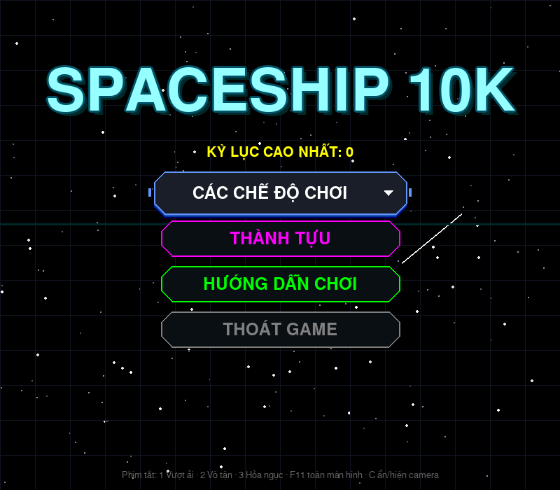
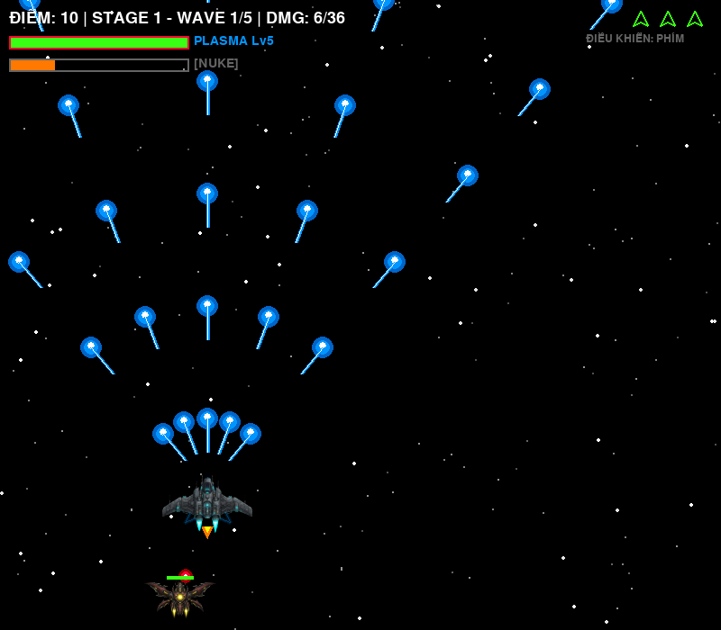
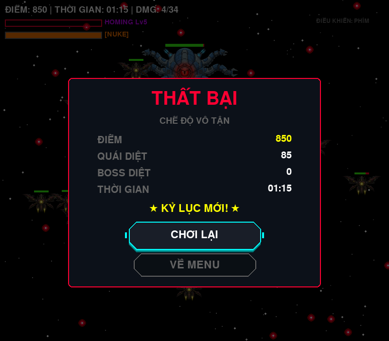

<h2 align="center">
    <a href="https://dainam.edu.vn/vi/khoa-cong-nghe-thong-tin">
    🎓 Faculty of Information Technology (DaiNam University)
    </a>
</h2>
<h2 align="center">
   SpaceShip10k
</h2>
<div align="center">
    <p align="center">
        
        
        
    </p>

[](https://www.facebook.com/DNUAIoTLab)
[](https://dainam.edu.vn/vi/khoa-cong-nghe-thong-tin)
[](https://dainam.edu.vn)

</div>

---

## 1. Giới thiệu

Game bắn phi thuyền điều khiển **bằng cử chỉ tay qua webcam** (MediaPipe), làm trong môn
Công nghệ xử lý ảnh. Không có webcam vẫn chơi được bằng **bàn phím**.

> Phiên bản **2.0** là bản đại tu toàn bộ: tách code thành package `spaceship/`, sửa lỗi game chạy
> chậm theo webcam, thêm điều khiển bàn phím, lưu thống kê cộng dồn, có test tự động.
> Chi tiết thay đổi: [CHANGELOG.md](CHANGELOG.md) · Kiến trúc: [docs/ARCHITECTURE.md](docs/ARCHITECTURE.md)

## 2. Bối cảnh

Ở thiên niên kỷ thứ 12, nhân loại đã mở rộng ra khắp thiên hà. Trong một nhiệm vụ trinh sát
tại rìa không gian, tàu **KX-17** bất ngờ mất kết nối với trung tâm chỉ huy và bị một thực thể
chưa xác định tấn công. Không còn đường lui — chiến đấu, sống sót và tìm đường về tàu mẹ.

## 3. Hình ảnh

| Menu | Trong trận |
|:---:|:---:|
|  |  |
| **Đánh Boss** | **Kết quả** |
|  |  |

*Video demo (bản 1.0): [Xem video gameplay](https://drive.google.com/file/d/1O6J_LIKSlvcKQLEFiB_6ogn2hGoPeJ3p/view?usp=sharing)*

## 4. Cài đặt & chạy

Cần **Python 3.10 – 3.13**.

```bash
git clone https://github.com/trinhhuuhieu19122003-dotcom/CNXSLA-SpaceShip10k.git
cd CNXSLA-SpaceShip10k

python -m venv .venv
# Windows:  .venv\Scripts\activate      macOS/Linux:  source .venv/bin/activate
pip install -r requirements.txt

python -m spaceship              # hoặc: python main.py
```

Tuỳ chọn dòng lệnh:

| Lệnh | Ý nghĩa |
|---|---|
| `python -m spaceship --no-camera` | Tắt webcam, chơi bằng bàn phím |
| `python -m spaceship --camera 1` | Dùng webcam số 1 (khi máy có nhiều camera) |
| `python -m spaceship --fullscreen` | Mở toàn màn hình |
| `python -m spaceship --debug` | In log chi tiết để tìm lỗi |

> **MediaPipe:** game tự nhận bản MediaPipe bạn cài. Bản ≤ 0.10.21 dùng API cũ `mp.solutions`;
> bản mới (0.10.31 trở lên đã xóa API đó) dùng `HandLandmarker` — lần chạy đầu game tự tải model
> ~7.5 MB về thư mục dữ liệu. Nếu máy không có mạng, tải tay file theo đường link được in ra trong log.

## 5. Điều khiển

| Hành động | Bằng tay (webcam) | Bàn phím |
|---|---|---|
| Di chuyển | Di chuyển **lòng bàn tay** trong khung vàng trên ô camera | Mũi tên / WASD |
| Bắn | Giơ **1 ngón trỏ** | Space / J |
| Phóng Nuke (cần đầy thanh Nộ) | Giơ **3 ngón** (trỏ, giữa, áp út) | N / K |
| Tạm dừng | — | ESC / P |
| Toàn màn hình · ẩn/hiện camera | — | F11 · C |

Bàn phím và tay dùng được **cùng lúc**: đang bấm phím di chuyển thì phím được ưu tiên.

## 6. Chế độ chơi

| Chế độ | Mô tả |
|---|---|
| **Vượt ải** | 3 stage (5 / 7 / 10 wave), cuối mỗi stage có Boss. Hạ Boss 1 nhận **Drone**, Boss 2 nhận **Thiêu đốt**, hạ Boss 3 là thắng. |
| **Vô tận** | Sống sót càng lâu càng tốt. Độ khó tăng theo thời gian, Boss xuất hiện mỗi 60 giây. |
| **Hỏa ngục** | Mưa đạn: địch bắn 3 tia, vật phẩm hồi máu rất ít, không rơi khiên, Boss mỗi 45 giây. |

## 7. Vật phẩm

| Vật phẩm | Ký hiệu | Tác dụng |
|---|:---:|---|
| Hồi máu | `+` | +30 HP (Hỏa ngục: +5) |
| Khiên | `S` | Bất tử 3 giây, húc chết địch thường (Hỏa ngục: 1 giây) |
| Plasma | ▲ xanh | Đạn tỏa rộng, DMG 6 |
| Laser | ▲ đỏ | Sát thương cao, DMG 10. Cấp 6: tia xuyên thấu toàn màn hình |
| Homing | ▲ tím | Tên lửa tự đuổi, DMG 4 |
| Universal | ●●● | Nâng cấp súng đang dùng |
| Drone | `D` | Phi thuyền phụ tự bắn (rơi từ Boss 1) |
| Thiêu đốt | `B` | Đạn gây cháy 6 HP/giây (rơi từ Boss 2) |

Nhặt **cùng loại** súng → lên cấp (tối đa 6, sau đó cộng sát thương). Nhặt **khác loại** → đổi súng, về cấp 1.

## 8. Cấu trúc project

```
CNXSLA-SpaceShip10k/
├── main.py                  # Chạy kiểu cũ: python main.py (chỉ gọi spaceship.__main__)
├── requirements.txt
├── assets/
│   ├── images/              # Sprite đã cắt viền trong suốt, đúng tỉ lệ
│   └── audio/               # Nhạc nền + hiệu ứng
├── spaceship/               # ← toàn bộ code game
│   ├── __main__.py          # Điểm khởi chạy + tham số dòng lệnh
│   ├── app.py               # Game: cửa sổ, vòng lặp 60 tick/giây, chuyển scene
│   ├── config.py            # MỌI con số cân bằng game ở một chỗ
│   ├── core/                # Hạ tầng: scene, ảnh/font, âm thanh, file lưu
│   ├── input/               # Webcam + MediaPipe (luồng riêng), cử chỉ, bàn phím
│   ├── entities/            # Đối tượng: người chơi, địch, đạn, vật phẩm, hiệu ứng
│   ├── systems/             # Luật chơi: va chạm, rơi đồ, AI boss, kịch bản chế độ
│   ├── scenes/              # Màn hình: menu, cutscene, trận đấu, tạm dừng, kết quả...
│   └── ui/                  # Nút bấm, panel, HUD
├── tests/                   # 31 test tự động (chạy không cần màn hình/webcam)
└── docs/
    ├── ARCHITECTURE.md      # Giải thích kiến trúc + sơ đồ
    └── screenshots/
```

Dữ liệu lưu (kỷ lục, thống kê) nằm ở thư mục người dùng, **không** nằm trong repo:
Windows `%APPDATA%\SpaceShip10k\save.json`, macOS `~/Library/Application Support/SpaceShip10k/`, Linux `~/.local/share/SpaceShip10k/`
(đổi bằng biến môi trường `SPACESHIP_SAVE_DIR`). File `highscore.txt`/`stats.json` của bản cũ được tự nhập.

## 9. Chạy test

```bash
python -m unittest discover -s tests -t .
```

Test chạy ở chế độ không màn hình (SDL dummy), gồm cả một "bot" tự chơi hết 3 stage của
chế độ Vượt ải, đánh Boss ở Vô tận và Hỏa ngục để chắc chắn game không treo hay rò rỉ đạn.

## 10. Công nghệ sử dụng

[](https://www.python.org/)
[](https://www.pygame.org/)
[](https://opencv.org/)
[](https://ai.google.dev/edge/mediapipe)
[](https://numpy.org/)

## 11. Đóng góp

<a href="https://github.com/trinhhuuhieu19122003-dotcom/CNXSLA-SpaceShip10k/graphs/contributors">
  
</a>

## 12. Phát triển

Dự án được phát triển trong khuôn khổ môn học Công nghệ Xử lý Ảnh tại Đại học Đại Nam.

**Tác giả**:
[Anos2003](https://github.com/Anos2003)
[Tabisan805](https://github.com/Tabisan805)

**Giảng viên hướng dẫn**: Lê Trung Hiếu - Khoa Công nghệ Thông tin - Đại học Đại Nam

## 13. Giấy phép

Dự án này được phát triển cho mục đích giáo dục. Vui lòng không sử dụng thương mại mà không có sự đồng ý.
