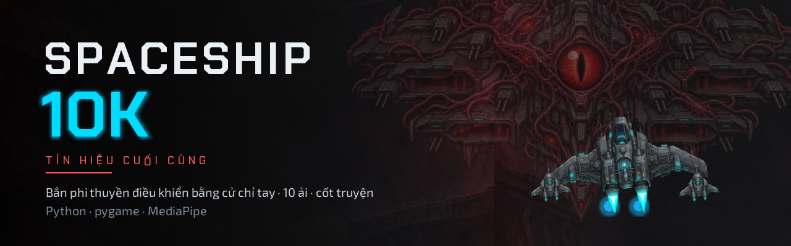
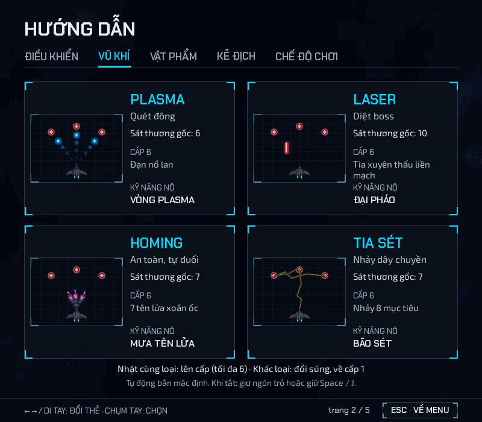
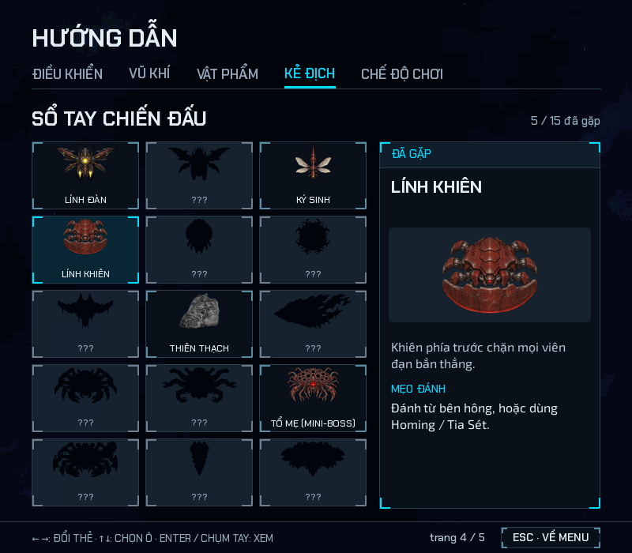

<p align="center">
  
</p>

<p align="center">
  
  
  
  
  
</p>

<p align="center">
  <b>Game bắn phi thuyền điều khiển bằng cử chỉ tay qua webcam</b><br>
  10 ải · 3 hồi · có cốt truyện · 4 loại súng · 5 boss · chơi được cả bằng bàn phím
</p>

---

> **Về nhánh này.** `refactor/dai-tu-v2` là **bản nâng cấp 2.x**, được viết lại và phát triển tiếp từ đồ án
> môn học gốc. Nhánh [`main`](https://github.com/trinhhuuhieu19122003-dotcom/CNXSLA-SpaceShip10k/tree/main)
> được **giữ nguyên** như bản đồ án thời đại học. Xem [Nguồn gốc & ghi công](#nguồn-gốc--ghi-công).

## Mục lục

- [Hình ảnh](#hình-ảnh)
- [Điểm nổi bật](#điểm-nổi-bật)
- [Cốt truyện](#cốt-truyện)
- [Cài đặt & chạy](#cài-đặt--chạy)
- [Điều khiển](#điều-khiển)
- [Chế độ chơi](#chế-độ-chơi)
- [Vũ khí & vật phẩm](#vũ-khí--vật-phẩm)
- [Kiến trúc mã nguồn](#kiến-trúc-mã-nguồn)
- [Kiểm thử](#kiểm-thử)
- [Lộ trình](#lộ-trình)
- [Nguồn gốc & ghi công](#nguồn-gốc--ghi-công)
- [Giấy phép](#giấy-phép)

## Hình ảnh

| Chọn ải | Hội thoại giữa các ải |
|:---:|:---:|
|  |  |
| **Trong trận: kỹ năng Vòng Plasma, pháo tháp cảnh báo** | **Boss cuối: Tàu Mẹ Hy Vọng** |
|  |  |
| **Hướng dẫn: súng bắn thử ngay trong thẻ** | **Sổ tay chiến đấu: mở dần khi gặp địch** |
|  |  |

## Điểm nổi bật

| | |
|---|---|
| **Điều khiển bằng tay, đỡ mỏi** | Hiệu chỉnh tư thế nghỉ, tì khuỷu tay, nhích tay một gang là lái hết màn hình. Tự động bắn, chụm ngón tung kỹ năng, nắm tay để né chậm, bỏ tay xuống là tự tạm dừng. |
| **Không cần webcam** | Bàn phím luôn hoạt động song song; máy không có camera vẫn chơi trọn vẹn. |
| **Chạy mượt trên mọi máy** | Camera và MediaPipe chạy ở luồng riêng; logic game cố định 60 bước/giây, không phụ thuộc tốc độ webcam. |
| **Chiến dịch có cốt truyện** | 10 ải chia 3 hồi, hội thoại có chân dung nhân vật, thoại ngay trong trận, đoạn kết riêng. |
| **Đồ họa phát sáng** | Đạn neon, vụ nổ có sóng xung kích, địch nháy khi trúng đạn, nền cuộn theo từng hồi. |
| **Có chiều sâu** | 4 súng, mỗi súng một dạng tối thượng ở cấp 6 và một kỹ năng Nộ riêng; 3 mức độ khó; chấm 1–3 sao mỗi ải. |
| **Mã nguồn sạch, có test** | Chia module rõ ràng, dữ liệu ải tách khỏi logic, 67 test tự động, có bot tự chơi hết chiến dịch. |

## Cốt truyện

Thiên niên kỷ thứ 12. Trong một nhiệm vụ trinh sát ở rìa thiên hà, phi công **KX-17** mất liên lạc với cả phi đội
và tàu mẹ **Hy Vọng**. Chỉ còn trí tuệ nhân tạo **ARIA** bên cạnh, KX-17 lần theo tín hiệu yếu ớt của tàu mẹ, băng qua
lãnh địa của **Đàn Ký Sinh**: một chủng loài nửa sinh vật nửa máy móc, không chế tạo gì cả, chỉ chiếm lấy.

Càng đến gần nhà, KX-17 càng nhận ra tín hiệu ấy có điều gì đó không đúng...

| Hồi | Các ải |
|---|---|
| **I · Lạc lối** | 1 Vành đai Mất Tín Hiệu · 2 Mưa Thiên Thạch · 3 Ổ Phục Kích |
| **II · Bãi tha ma** | 4 Bãi Xác Tàu · 5 Tinh vân Đỏ · 6 Tổ Đàn · 7 Lõi Tinh vân |
| **III · Trở về** | 8 Trạm Tiền Tiêu · 9 Hạm Đội Hộ Tống · 10 Tàu Mẹ |

## Cài đặt & chạy

**Yêu cầu:** Python 3.10 – 3.13, webcam (không bắt buộc).

```bash
git clone -b refactor/dai-tu-v2 https://github.com/trinhhuuhieu19122003-dotcom/CNXSLA-SpaceShip10k.git
cd CNXSLA-SpaceShip10k

python -m venv .venv
# Windows: .venv\Scripts\activate        macOS / Linux: source .venv/bin/activate
pip install -r requirements.txt

python -m spaceship
```

| Tham số | Ý nghĩa |
|---|---|
| `--no-camera` | Tắt webcam, chỉ chơi bằng bàn phím |
| `--camera N` | Chọn webcam số N khi máy có nhiều camera |
| `--fullscreen` | Mở toàn màn hình |
| `--seed N` | Cố định ngẫu nhiên (để tái hiện lỗi) |
| `--debug` | In log chi tiết |

<details>
<summary><b>Ghi chú về MediaPipe</b></summary>

Game tự nhận phiên bản MediaPipe đã cài. Bản ≤ 0.10.21 dùng API `mp.solutions.hands`; từ 0.10.31 API này bị xóa nên
game chuyển sang `HandLandmarker` (Tasks API) và tự tải model (~7.5 MB) một lần vào thư mục dữ liệu người dùng.
Máy không có mạng: tải tay file theo đường link in ra trong log.
</details>

<details>
<summary><b>Dữ liệu lưu ở đâu?</b></summary>

Kỷ lục, tiến độ chiến dịch và cài đặt được lưu ngoài thư mục game:
Windows `%APPDATA%\SpaceShip10k\`, macOS `~/Library/Application Support/SpaceShip10k/`,
Linux `~/.local/share/SpaceShip10k/` (đổi bằng biến môi trường `SPACESHIP_SAVE_DIR`).
Dữ liệu của bản gốc (`highscore.txt`, `stats.json`) được tự nhập ở lần chạy đầu.
</details>

## Điều khiển

| Hành động | Bằng tay (webcam) | Bàn phím |
|---|---|---|
| Lái tàu | Di chuyển **lòng bàn tay** (thả lỏng, tì khuỷu tay lên bàn) | Mũi tên / WASD |
| Bắn | **Tự động** (tắt được trong Cài đặt; khi tắt: giơ 1 ngón trỏ) | Tự động / Space / J |
| Kỹ năng Nộ (khi đầy thanh) | **Chụm đầu ngón cái + ngón trỏ**, giữ 0,5 giây | K / N |
| Né chậm, hiện điểm va chạm | **Nắm tay** | Shift |
| Tạm dừng | **Bỏ tay xuống** ~1,5 giây (đưa tay lên lại sẽ tự đếm 3‑2‑1) | Esc / P |
| Toàn màn hình · ẩn/hiện camera | — | F11 · C |

Lần đầu chơi mỗi khi mở game, màn **Hiệu chỉnh tay** ghi nhận tư thế nghỉ của bạn làm tâm màn hình.
Độ nhạy tay (Thấp / Vừa / Cao) và hiệu chỉnh lại nằm trong **Cài đặt**. Tay trái hay tay phải đều được.

## Chế độ chơi

| Chế độ | Mô tả |
|---|---|
| **Vượt ải** | 10 ải có cốt truyện. Chọn ải và độ khó **Dễ / Thường / Khó**; mỗi ải chấm **1–3 sao** (qua ải · mất tối đa 1 mạng · không mất mạng). Tiến độ được lưu. |
| **Vô tận** | Sống sót càng lâu càng tốt. Càng về sau càng nhiều loại địch; boss đổi loại mỗi 60 giây. |
| **Hỏa ngục** | *Mở khóa sau khi phá đảo.* Mưa đạn, ít máu, không rơi khiên, boss mỗi 45 giây. |

**Kẻ địch:** lính thường, kamikaze, Ký Sinh (bầy lượn sóng), Lính Khiên (chặn đạn bắn thẳng), Kẻ Đẻ Trứng,
pháo tháp (kẻ vạch đỏ trước khi bắn), tàu đồng minh bị nhiễm, thiên thạch, xác tàu (núp được).
**Boss:** Kẻ Nuốt Drone, Tổ Mẹ, Lõi Tinh vân, Tàu Hộ Tống, Tàu Mẹ Hy Vọng (3 pha).

## Vũ khí & vật phẩm

| Súng | Vai trò | Cấp 6 | Kỹ năng Nộ |
|---|---|---|---|
| **Plasma** | Quét đông | Đạn nổ lan | **Vòng Plasma**: vòng nổ quanh tàu, xóa đạn địch |
| **Laser** | Diệt boss | Tia xuyên thấu liền mạch | **Đại Pháo**: tia khổng lồ 3 giây |
| **Homing** | An toàn, tự đuổi | 7 tên lửa xoắn ốc | **Mưa Tên Lửa**: 20 tên lửa |
| **Tia Sét** | Nhảy dây chuyền | Nhảy 8 mục tiêu | **Bão Sét**: sét đánh mọi địch 3 lần |

Nhặt **cùng loại** súng thì lên cấp (tối đa 6, sau đó cộng sát thương). Nhặt **khác loại** thì đổi súng và **về cấp 1**,
một luật có chủ đích để người chơi phải né cả vật phẩm. Hộp súng khác loại sẽ nháy viền đỏ kèm dấu "!" để cảnh báo.

| Vật phẩm | Tác dụng |
|---|---|
| Hồi máu | +30 HP (Hỏa ngục: +5) |
| Khiên | Bất tử 3 giây, húc chết địch thường |
| Universal | Nâng cấp súng đang dùng |
| Drone (tối đa 2) | Phi thuyền phụ tự bắn. Thưởng khi hạ boss ải 3 và ải 9 |
| Thiêu đốt | Đạn gây cháy 6 HP/giây. Thưởng khi hạ boss ải 7 |

Phần thưởng boss tự bay vào tàu, không bao giờ rơi mất.

## Kiến trúc mã nguồn

```
spaceship/
├── __main__.py      Điểm khởi chạy, tham số dòng lệnh
├── app.py           Game: cửa sổ, vòng lặp cố định 60 tick/giây, chuyển scene
├── config.py        Mọi con số cân bằng game ở một chỗ
├── core/            Hạ tầng: scene, ảnh & font, âm thanh, lưu trữ, cài đặt
├── input/           Webcam + MediaPipe (luồng riêng), lọc rung One Euro, nhận dạng cử chỉ, bàn phím
├── entities/        Người chơi, kẻ địch, boss, đạn, vật phẩm, hiệu ứng
├── systems/         Luật chơi: va chạm, vũ khí & kỹ năng, rơi đồ, AI địch/boss, điều phối ải
├── campaign/        Dữ liệu 10 ải (levels.py) và toàn bộ lời thoại (story.py)
├── scenes/          Menu, chọn ải, hội thoại, trận đấu, tạm dừng, kết quả, cài đặt, hiệu chỉnh tay
└── ui/              Hiệu ứng phát sáng, HUD, nút & khung
assets/              Ảnh, nhạc, âm thanh
tests/               Test tự động (chạy không cần màn hình/webcam)
docs/                Tài liệu kiến trúc, ảnh minh họa
```

- Thêm hoặc sửa ải chỉ cần sửa dữ liệu trong `campaign/levels.py`, không đụng tới logic.
- Sửa lời thoại trong `campaign/story.py`.
- Chi tiết thiết kế, sơ đồ luồng xử lý và bảng "muốn sửa X thì mở file nào": [docs/ARCHITECTURE.md](docs/ARCHITECTURE.md).
- Lịch sử thay đổi: [CHANGELOG.md](CHANGELOG.md).

## Kiểm thử

```bash
python -m unittest discover -s tests -t .
```

Test chạy ở chế độ không màn hình và không cần webcam (camera được thay bằng `FakeTracker`), gồm:
nhận dạng cử chỉ, lọc rung, lưu trữ, luật chiến đấu, điều phối từng ải, điều khiển tay, và một **bot tự chơi
hết 10 ải tới đoạn kết** cùng hai chế độ Vô tận và Hỏa ngục để bảo đảm game không treo hay rò rỉ đạn.

## Lộ trình

- [x] Đại tu kiến trúc, sửa lỗi bản gốc, thêm điều khiển bàn phím
- [x] Điều khiển tay đỡ mỏi (hiệu chỉnh, độ nhạy, chụm ngón, nắm tay, tự tạm dừng)
- [x] Hiệu ứng phát sáng, HUD mới
- [x] Vũ khí mới, kỹ năng Nộ, 10 ải, cốt truyện, chọn ải, độ khó
- [x] Giao diện mới: font riêng (Chakra Petch, Exo 2), menu điều khiển được bằng tay, đồng bộ phong cách các màn hình
- [x] Màn Hướng dẫn chia thẻ + Sổ tay chiến đấu
- [ ] Âm thanh: tiếng riêng cho từng sự kiện, nhạc theo từng hồi, chỉnh âm lượng
- [ ] Cân bằng độ khó theo phản hồi chơi thử thực tế

## Nguồn gốc & ghi công

**Bản gốc (nhánh `main`):** đồ án môn **Công nghệ Xử lý Ảnh**, Khoa Công nghệ Thông tin, Trường Đại học Đại Nam.

- Tác giả: [Anos2003](https://github.com/Anos2003), [Tabisan805](https://github.com/Tabisan805)
- Giảng viên hướng dẫn: **Lê Trung Hiếu**, Khoa Công nghệ Thông tin, Đại học Đại Nam

[](https://dainam.edu.vn/vi/khoa-cong-nghe-thong-tin)
[](https://dainam.edu.vn)
[](https://www.facebook.com/DNUAIoTLab)

**Bản nâng cấp 2.x (nhánh này):** phát triển bởi [trinhhuuhieu19122003-dotcom](https://github.com/trinhhuuhieu19122003-dotcom)
cùng trợ lý lập trình AI Claude (Anthropic). Hình minh họa mới (kẻ địch, boss, chân dung nhân vật, ảnh nền, ảnh kết)
được tạo bằng công cụ tạo ảnh AI thông qua Codex.

## Giấy phép

Dự án phục vụ mục đích học tập, phi thương mại. Vui lòng không sử dụng cho mục đích thương mại khi chưa có sự đồng ý
của tác giả. Font chữ Chakra Petch và Exo 2 dùng giấy phép SIL Open Font License (xem `assets/fonts/`).
