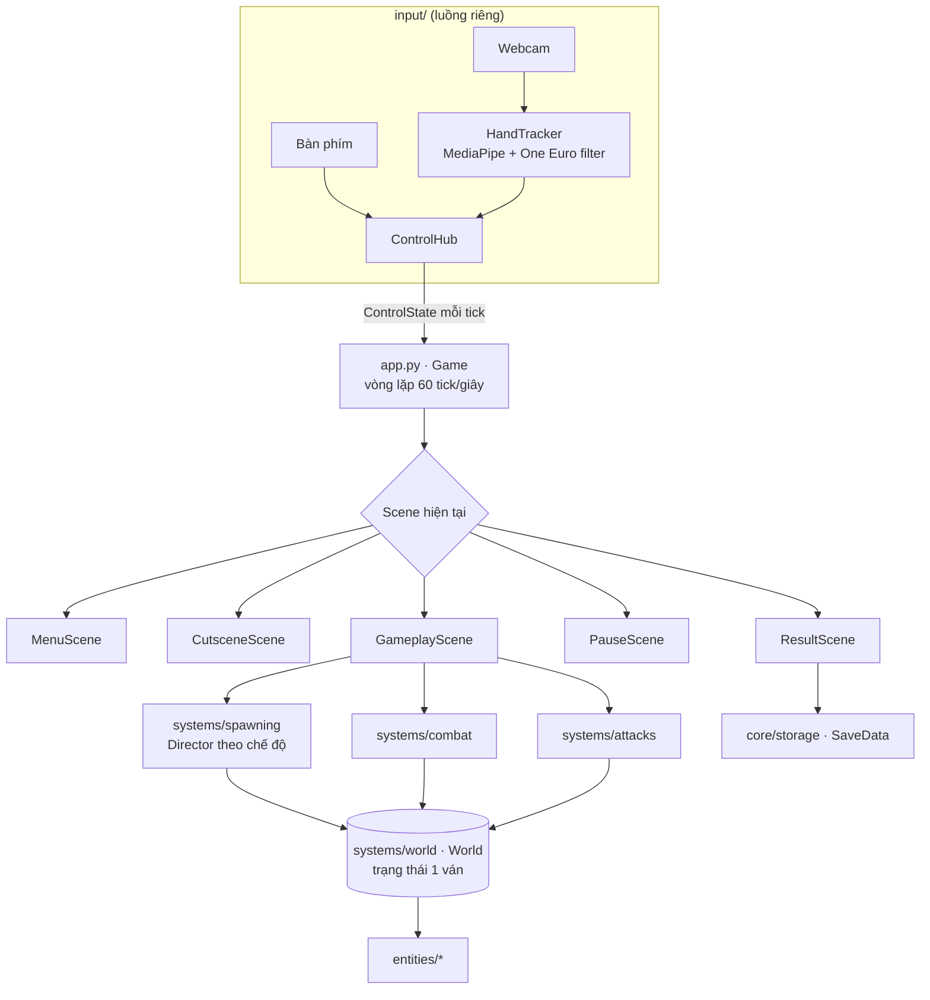
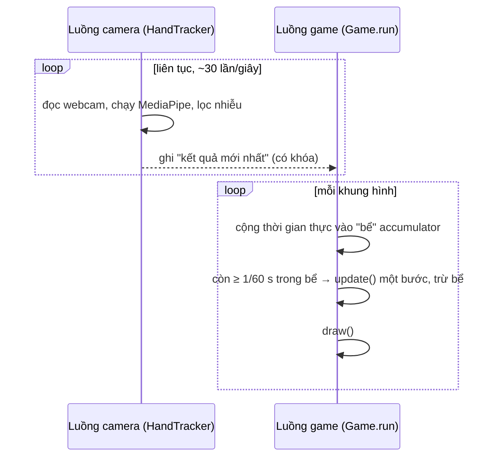

# Kiến trúc SpaceShip10k 2.0

Tài liệu này giải thích **code được chia thế nào và vì sao**, để người mới đọc vào là biết
muốn sửa gì thì mở file nào.

## 1. Bức tranh tổng thể

Ví dụ dễ hình dung: game giống một **nhà hàng**.

| Trong nhà hàng | Trong game | Thư mục |
|---|---|---|
| Quản lý ca (mở cửa, điều phối) | `Game` – cửa sổ, vòng lặp, chuyển màn | `app.py` |
| Các phòng (sảnh, phòng ăn, quầy thu ngân) | Scene – menu, trận đấu, kết quả... | `scenes/` |
| Nhân viên nhận order | Bàn phím + webcam → `ControlState` | `input/` |
| Bếp – nơi có công thức nấu | Luật chơi: va chạm, rơi đồ, AI boss | `systems/` |
| Nguyên liệu | Người chơi, địch, đạn, vật phẩm | `entities/` |
| Bàn ghế, thực đơn in sẵn | Nút, panel, HUD | `ui/` |
| Kho, sổ sách | Ảnh, âm thanh, file lưu | `core/` |
| Bảng giá treo tường | Mọi con số cân bằng | `config.py` |

Bản 1.0 dồn tất cả vào `main.py` (991 dòng, hàm `main()` ~700 dòng) — giống một người vừa
nấu, vừa bưng, vừa thu tiền. Bản 2.0 tách mỗi việc cho một chỗ.

## 2. Vòng lặp: vì sao bản cũ chạy chậm theo webcam

Bản cũ, mỗi khung hình: `cap.read()` (chờ webcam, ~33 ms) → MediaPipe → cập nhật → vẽ →
`clock.tick(60)`. Webcam 30 fps ⇒ game chỉ được ~30 lần cập nhật/giây ⇒ **mọi thứ chậm một nửa**,
và máy yếu hơn thì càng chậm.

Bản mới tách làm hai:

Game chỉ **đọc kết quả mới nhất**, không bao giờ đứng chờ webcam. Logic luôn chạy đúng 60
bước/giây (mô hình *fixed timestep*) nên tốc độ game giống nhau trên mọi máy.

## 3. Thứ tự cập nhật một tick trong trận

`GameplayScene.update()` chỉ là "bản nhạc", mỗi dòng gọi một hệ thống:

1. Director (kịch bản chế độ) → ra quân / gọi boss / qua màn / thắng
2. Người chơi di chuyển, hồi chiêu, bắn, drone, nuke
3. Đạn người chơi bay → `combat.resolve_player_bullets`
4. Đạn địch bay → `combat.resolve_enemy_bullets`
5. `attacks.run_enemy_ai` (địch di chuyển + bắn, boss 3 pha)
6. `combat.apply_burn`, `combat.resolve_body_collisions`
7. `combat.reap_dead` — **mọi** cái chết của địch đi qua `kill_enemy` (điểm, rơi đồ, hiệu ứng)
8. Vật phẩm rơi + nhặt, hiệu ứng, `combat.cleanup` (xóa thứ ra khỏi màn hình, đủ 4 mép)
9. Có kết quả thắng/thua → lưu `SaveData` → chuyển `ResultScene`

## 4. Muốn sửa X thì mở file nào?

| Muốn... | Mở |
|---|---|
| Đổi sát thương, máu, điểm, thời gian khiên | `spaceship/config.py` |
| Thêm kiểu bắn mới cho boss | `systems/attacks.py` – thêm một hàm `_stageN` |
| Đổi đội hình wave | `systems/spawning.py` – `formation()` |
| Đổi tỉ lệ rơi đồ | `systems/loot.py` |
| Thêm loại vật phẩm | `entities/items.py` (hình) + `systems/combat.collect_items` (tác dụng) |
| Thêm cử chỉ tay | `input/gestures.classify` + `input/controls.ControlHub.poll` |
| Thêm màn hình mới | tạo `scenes/ten_man.py` kế thừa `Scene`, gọi `game.change_scene(...)` |

## 5. Tham khảo từ các dự án tương tự

| Nguồn | Học được gì | Áp dụng ở |
|---|---|---|
| [omarkhan03/cv-game](https://github.com/omarkhan03/cv-game), [zion-dev1/platformer](https://github.com/zion-dev1/platformer) | Game pygame + MediaPipe: hiện khung camera ngay trong cửa sổ game, không mở cửa sổ OpenCV riêng | `app._draw_camera_overlay` |
| [pygame-gesture-kit](https://pypi.org/project/pygame-gesture-kit) | Tách hẳn phần camera/nhận diện thành module riêng, game chỉ hỏi "tay đang ở đâu" | `input/hand_tracker.py` |
| [Catcher Games – menus & scenes](https://holdenrehg.github.io/catchergames/2021/06/22/menus-and-scenes.html), [PyScenes](https://github.com/treygilliland/PyScenes) | Mỗi màn hình là một lớp Scene, `Game` giữ `next_scene` | `core/scene.py`, `Game.change_scene` |
| [Real Python – Asteroids](https://realpython.com/asteroids-game-python/), [SanctumLabs/space-rocks](https://github.com/SanctumLabs/space-rocks) | Package + thư mục `assets/` tách riêng, vòng lặp input → logic → vẽ | cây thư mục, `assets/` |
| One Euro Filter (Casiez et al., CHI 2012) | Lọc rung tay: đứng yên thì mượt, di nhanh thì ít trễ | `input/filters.py` |
| MediaPipe issue [#6192](https://github.com/google-ai-edge/mediapipe/issues/6192) | 0.10.31 xóa `mp.solutions` → cần hỗ trợ `HandLandmarker` | `input/backends.py` |

## 6. Test

`tests/` dùng `unittest` có sẵn của Python, không cần cài thêm:

- `test_gestures.py` – nhận dạng cử chỉ (kể cả tay xoay ngang), lọc nhiễu, chống nháy cử chỉ
- `test_storage.py` – cộng dồn thống kê, file hỏng được sao lưu, nhập dữ liệu bản cũ
- `test_gameplay_rules.py` – khiên boss, mạng sống, thiêu đốt, đạn rò rỉ, drone, nâng cấp, rơi đồ, kịch bản 3 stage
- `test_smoke.py` – chạy thật mọi scene + "bot" tự chơi cả 3 chế độ
