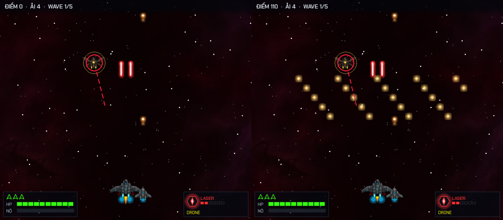

# Cảm giác đánh (game feel)

"Juice" là những hiệu ứng nhỏ không đổi luật chơi nhưng làm mỗi cú va chạm *có cảm giác*:
rung, khựng hình, chớp sáng, âm thanh. Tài liệu này ghi lại SpaceShip10K dùng những gì và vì sao.

## 1. Rung kiểu "trauma"

**Trước:** cứ có rung là lệch ngẫu nhiên ±8 px trong N tick, cú nhẹ hay nặng đều giống nhau.

**Giờ:** mỗi sự kiện *cộng* trauma (0..1), độ lệch = `SHAKE_MAX_OFFSET × trauma²`, trauma giảm `TRAUMA_DECAY`
mỗi tick.

| Sự kiện | `shake(...)` | trauma | Lệch tối đa |
|---|---|---|---|
| Hạ địch to | 4 | 0,2 | ~0,5 px |
| Trúng đạn | 10 | 0,5 | 3 px |
| Hạ boss | 20 | 1,0 | 12 px |

Bình phương là mấu chốt: cú nhẹ gần như không rung, cú nặng giật mạnh. Người chơi không bị "nhờn" rung.

## 2. Khựng hình (hitstop)

Đóng băng mô phỏng vài tick (1 tick = 1/60 giây) để não kịp ghi nhận cú đánh.

| Sự kiện | Tick | ≈ ms |
|---|---|---|
| Hạ địch to (Lính Khiên, Đẻ Trứng, Pháo tháp) | 3 | 50 |
| Trúng đạn | 4 | 67 |
| Mất một mạng | 10 | 167 |
| Hạ boss | 12 | 200 |

* Lấy **giá trị lớn nhất**, không cộng dồn: kỹ năng Nộ nổ cả loạt địch vẫn chỉ khựng một lần.
* Lính thường **không** khựng: chết quá nhiều, khựng liên tục sẽ thành giật lag.
* Thông báo (ĐỊCH MỚI, câu thoại) vẫn chạy trong lúc khựng.

## 3. Bất tử ngắn sau khi trúng đạn (mercy frames)

Trước đây chỉ có bất tử sau khi hồi sinh. Một chùm 3 viên đạn sát nhau có thể trừ 45 máu trong 3 tick:
người chơi không kịp phản ứng, nhất là khi lái bằng tay (chậm hơn bàn phím).

Giờ sau mỗi lần trúng đạn được bất tử `MERCY_TICKS` = 30 tick (0,5 giây). Lúc bất tử tàu chỉ ẩn 1/4 thời gian
(trước là 1/2), vì đang né đạn mà tàu biến mất thì càng dễ chết oan.

## 4. Viền đỏ & chớp sáng

* **Viền đỏ** loé lên khi trúng đạn rồi tắt dần. Khi máu ≤ 30% thì đập theo nhịp tim (~1,3 nhịp/giây), để người
  chơi biết mình sắp chết mà không cần nhìn xuống thanh máu.
* **Chớp sáng** của kỹ năng Nộ trước là `fill(WHITE)`, trắng xóa cả màn. Giờ là lớp trắng bán trong suốt (tối đa
  alpha 150), mờ dần. Đỡ chói và đỡ nguy hiểm cho người nhạy cảm với ánh sáng nhấp nháy.

## 5. Cài đặt "Rung & nháy màn hình"

`ĐẦY ĐỦ` (×1) · `NHẸ` (×0,4) · `TẮT` (×0), áp cho rung và chớp sáng. Viền đỏ là **thông tin** nên vẫn giữ;
chỉ nhịp đập là đứng yên khi `TẮT`. Hướng dẫn trợ năng của nhiều game đều khuyên có tùy chọn này.

## 6. Lính cảm tử báo trước khi lao (telegraph)

**Trước:** lính cảm tử còn dưới 40% máu là lập tức bám theo tàu, tốc độ 8 px/tick, bẻ lái tức thời. Muốn sống
thì chỉ có cách hạ nó; né thì không được.

**Giờ:** đọc được và né được.

1. **Khóa mục tiêu** 30 tick (0,5 giây). Thân rung, vòng đỏ co dần, vòng vàng nhấp nháy, vạch đứt khúc chỉ hướng
   sẽ lao, kèm tiếng bíp `lock_on`.
2. **Lao.** Trong 20 tick đầu chỉ bẻ lái được 1°/tick, sau đó bay thẳng. Lao trượt ra khỏi màn thì bị dọn.

Thử nghiệm (có test): người chơi đứng yên thì vẫn bị đâm; né ngang 250 px ngay khi nó lao thì trượt.

## 7. Hủy đạn khi hạ boss / boss đổi pha

Đạn địch còn trên màn biến thành tia sáng vàng, +5 điểm mỗi viên, kèm tiếng `bullet_cancel`. Đây là cách các game
bắn tàu Nhật (dòng "bullet hell") thưởng cho người chơi. Nó cũng tránh chết oan vì đạn sót lại đúng lúc khung cảnh
đang đổi. Boss sang pha mới (66% và 33% máu) cũng dọn đạn, tạo một nhịp thở ngắn trước kiểu bắn mới.

## 8. Chuỗi hạ địch

Hạ liên tiếp, mỗi lần cách nhau dưới 2,5 giây, để nhân điểm: 10 lần x2, 20 lần x3, 30 lần x4. **Trúng đạn là mất
chuỗi.** Vì vậy chơi liều để giữ chuỗi có lợi về điểm, nhưng một lần sơ sẩy là mất hết.

Chuỗi hiện ở mấy chỗ:

* "CHUỖI xN" nổi lên trên tàu lúc lên bậc.
* Dải điểm trên cùng.
* Bảng trái ở màn rộng, kèm thanh thời gian còn lại.
* Màn Kết quả ghi chuỗi dài nhất.

## 9. Sát đạn (graze)

Đạn địch bay sượt qua trong 34 px quanh tâm tàu mà không trúng (vùng trúng chỉ 15 px) thì được +2 điểm (nhân
theo chuỗi), có tia sáng nhỏ, tiếng "xẹt", và **giữ chuỗi hạ không bị đứt**. Mỗi viên chỉ tính một lần. Lúc đang
bất tử thì không tính, để không "cày" điểm được. Cơ chế này lấy từ các game bắn tàu như Touhou và Psyvariar:
thưởng cho người dám luồn lách sát đạn thay vì luôn né thật xa, và hợp với chế độ **né chậm** (nắm tay / Shift)
vốn đã hiện vùng trúng thật của tàu.

## 10. Tim đập

Khi máu ≤ 30%, tiếng `heartbeat` ("thịch-thịch" trầm) phát đúng nhịp viền đỏ (1,3 nhịp/giây). Viền đậm nhất ngay
lúc tim đập.

## Tham khảo

* Mark Brown (Game Maker's Toolkit), *Secrets of Game Feel and Juice*, tổng hợp từ talk của Jan Willem Nijman
  (Vlambeer), *The Art of Screenshake*.
* Squirrel Eiserloh, GDC 2016, *Math for Game Programmers: Juicing Your Cameras With Math*: mô hình trauma²
  cho rung màn hình.
* [Juice that matters: hitstop, shake, particles, and audio](https://molbv.github.io/blog/2025-06-24-juice-polish.html):
  hitstop ngắn 40–60 ms cho cú đánh thường, dành rung mạnh cho khoảnh khắc lớn.
* [Game feel 2D combat juice tricks](https://freegamesprites.com/ar/news/game-feel-2d-combat-juice-tricks):
  đừng rung mọi cú đánh, người chơi sẽ "nhờn".
