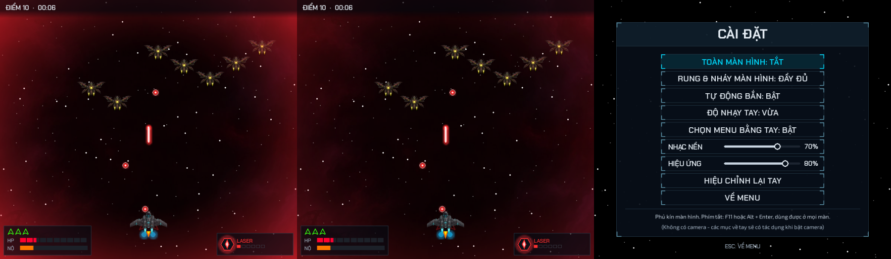

# Cảm giác đánh (game feel)

"Juice" là những hiệu ứng nhỏ không đổi luật chơi nhưng làm mỗi cú va chạm *có cảm giác*:
rung, khựng hình, chớp sáng, âm thanh. Tài liệu này ghi lại SpaceShip10K dùng những gì và vì sao.

## 1. Rung kiểu "trauma"

**Trước:** cứ có rung là lệch ngẫu nhiên ±8 px trong N tick, cú nhẹ hay nặng đều giống nhau.

**Giờ:** mỗi sự kiện *cộng* trauma (0..1), độ lệch = `SHAKE_MAX_OFFSET × trauma²`, trauma giảm `TRAUMA_DECAY`
mỗi tick.

| Sự kiện | `shake(...)` | trauma | Lệch tối đa |
|---|---|---|---|
| Hạ địch to | 4 | 0,2 | ~0,5 px |
| Trúng đạn | 10 | 0,5 | 3 px |
| Hạ boss | 20 | 1,0 | 12 px |

Bình phương là mấu chốt: cú nhẹ gần như không rung, cú nặng giật mạnh. Người chơi không bị "nhờn" rung.

## 2. Khựng hình (hitstop)

Đóng băng mô phỏng vài tick (1 tick = 1/60 giây) để não kịp ghi nhận cú đánh.

| Sự kiện | Tick | ≈ ms |
|---|---|---|
| Hạ địch to (Lính Khiên, Đẻ Trứng, Pháo tháp) | 3 | 50 |
| Trúng đạn | 4 | 67 |
| Mất một mạng | 10 | 167 |
| Hạ boss | 12 | 200 |

* Lấy **giá trị lớn nhất**, không cộng dồn: kỹ năng Nộ nổ cả loạt địch vẫn chỉ khựng một lần.
* Lính thường **không** khựng: chết quá nhiều, khựng liên tục sẽ thành giật lag.
* Thông báo (ĐỊCH MỚI, câu thoại) vẫn chạy trong lúc khựng.

## 3. Bất tử ngắn sau khi trúng đạn (mercy frames)

Trước đây chỉ có bất tử sau khi hồi sinh. Một chùm 3 viên đạn sát nhau có thể trừ 45 máu trong 3 tick:
người chơi không kịp phản ứng, nhất là khi lái bằng tay (chậm hơn bàn phím).

Giờ sau mỗi lần trúng đạn được bất tử `MERCY_TICKS` = 30 tick (0,5 giây). Lúc bất tử tàu chỉ ẩn 1/4 thời gian
(trước là 1/2), vì đang né đạn mà tàu biến mất thì càng dễ chết oan.

## 4. Viền đỏ & chớp sáng

* **Viền đỏ** loé lên khi trúng đạn rồi tắt dần. Khi máu ≤ 30% thì đập theo nhịp tim (~1,3 nhịp/giây), để người
  chơi biết mình sắp chết mà không cần nhìn xuống thanh máu.
* **Chớp sáng** của kỹ năng Nộ trước là `fill(WHITE)`, trắng xóa cả màn. Giờ là lớp trắng bán trong suốt (tối đa
  alpha 150), mờ dần. Đỡ chói và đỡ nguy hiểm cho người nhạy cảm với ánh sáng nhấp nháy.

## 5. Cài đặt "Rung & nháy màn hình"

`ĐẦY ĐỦ` (×1) · `NHẸ` (×0,4) · `TẮT` (×0), áp cho rung và chớp sáng. Viền đỏ là **thông tin** nên vẫn giữ;
chỉ nhịp đập là đứng yên khi `TẮT`. Hướng dẫn trợ năng của nhiều game đều khuyên có tùy chọn này.

## Tham khảo

* Mark Brown (Game Maker's Toolkit), *Secrets of Game Feel and Juice*, tổng hợp từ talk của Jan Willem Nijman
  (Vlambeer), *The Art of Screenshake*.
* Squirrel Eiserloh, GDC 2016, *Math for Game Programmers: Juicing Your Cameras With Math*: mô hình trauma²
  cho rung màn hình.
* [Juice that matters: hitstop, shake, particles, and audio](https://molbv.github.io/blog/2025-06-24-juice-polish.html):
  hitstop ngắn 40–60 ms cho cú đánh thường, dành rung mạnh cho khoảnh khắc lớn.
* [Game feel 2D combat juice tricks](https://freegamesprites.com/ar/news/game-feel-2d-combat-juice-tricks):
  đừng rung mọi cú đánh, người chơi sẽ "nhờn".
