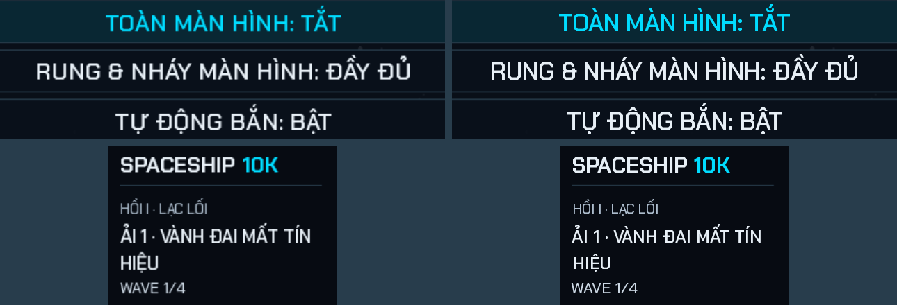

# Chữ sắc nét khi toàn màn hình

## Vấn đề

Cả game vẽ trên một tấm **800x700** rồi phóng lên cửa sổ. Ví dụ đời thường: chụp ảnh màn hình điện thoại rồi phóng
to trên TV. Ảnh tàu, vụ nổ hơi mềm thì không ai để ý, nhưng **chữ** thì nhòe thấy rõ.

* Cửa sổ thường đã chọn cỡ bội số nguyên (800x700, 1600x1400...). Mỗi điểm ảnh game ứng với đúng 1 (hoặc 2x2)
  điểm ảnh màn hình nên luôn nét.
* Toàn màn hình 1080p phải phóng **1,54 lần**, một tỉ lệ lẻ, nên ảnh phải làm mượt và chữ bị nhòe.

Cách "chuẩn" là vẽ mọi thứ ở độ phân giải gốc, nhưng phải sửa khoảng 400 chỗ đặt toạ độ trong code. Thay vào đó,
game chỉ vẽ lại **chữ**.

## Cách làm (`spaceship/ui/crisp.py`)

1. **Chữ nhớ cách nó được vẽ.** `Assets.text(...)` trả về `TextSurface`: vẫn là một `pygame.Surface` bình thường,
   nhưng có thêm `spec = (chữ, cỡ, màu, đậm, nghiêng, font)`.
2. **Tấm vẽ ghi lại chữ.** Tấm 800x700 (và tấm 2 bảng bên ở màn rộng) là `CrispSurface`. Khi bật chế độ nét
   (phóng > 1,05 lần), lệnh `blit` một `TextSurface` **không vẽ ngay**, chỉ ghi lại: chữ gì, ở ô nào, độ trong suốt.
3. **Phóng ảnh như cũ**, lúc này ảnh chưa có chữ.
4. **Vẽ lại chữ ở cỡ lớn** trên ảnh đã phóng. Font cỡ `cỡ x 1,54` được render thẳng ở độ phân giải màn hình.
   Font to không rộng đúng 1,54 lần font nhỏ (do làm tròn nét chữ), nên game thử vài cỡ quanh đó và chọn cỡ có
   bề rộng khớp nhất. Chữ đặt theo **tâm** ô cũ, nên chữ canh trái, phải hay giữa đều không lệch.

## Giữ đúng thứ tự vẽ

Nếu chữ chỉ được vẽ ở cuối thì nó sẽ nổi lên trên mọi thứ, kể cả những thứ đáng lẽ phải che nó. Ví dụ: màn
Tạm dừng phủ một lớp tối lên trận đấu, nên chữ "ĐIỂM" của trận phía sau phải tối theo.

Quy tắc: khi có thứ gì được vẽ **đè lên vùng** của một chữ đang chờ, chữ đó được vẽ thường (độ phân giải thấp)
**ngay trước** vật đè. Cụ thể:

* `blit` ảnh khác lên vùng có chữ: chữ được vẽ trước.
* `fill` cả màn không kèm hiệu ứng: chữ cũ bị xóa (vì đằng nào cũng bị tô kín).
* `fill` kèm hiệu ứng (vd. phủ tối): chữ được vẽ trước.

Kết quả là chữ phía trên cùng (chữ người chơi đang đọc) sắc nét, còn chữ bị che vẫn bị che đúng như cũ.

Cuối mỗi hình, chữ còn chờ cũng được vẽ thường vào tấm 800x700, để hiệu ứng chuyển cảnh (chụp lại hình cũ) vẫn
đủ chữ.

## Giới hạn

* Chữ vẽ lên một tấm phụ rồi mới dán vào màn hình (ô HUD góc ở chế độ khung hẹp) vẫn đi theo đường cũ. Ở màn
  rộng, HUD nằm ở 2 bảng bên nên vẫn nét.
* Chữ bị phóng/xoay bằng `pygame.transform` không còn là `TextSurface` nên vẽ như cũ.
* `pygame.draw.*` vẽ **đè lên** chữ thì không chặn được. Trong game hiện tại không có chỗ nào như vậy.

## Hiệu năng

Chữ cỡ lớn được cache (600 mục gần nhất), nên mỗi hình chỉ tốn thêm vài lệnh `blit`. Đo ở 1920x1080:
trận đấu màn rộng khoảng 8–10 ms mỗi hình, bằng lúc chưa bật.
